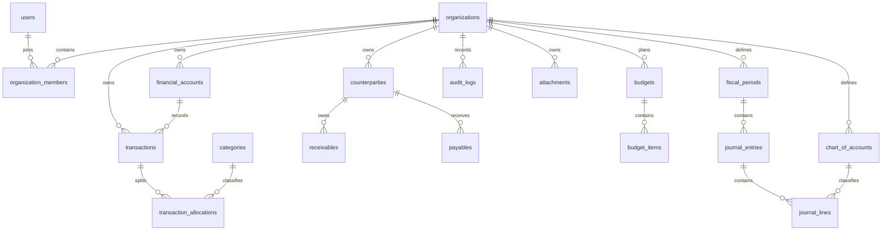

# CFIS Phase 1 设计与环境检查

状态：Phase 1 已实施，实际验证结果见 phase-1-validation.md；等待确认再进入 Phase 2。

## 架构

Vue 3 + TypeScript + Vite + Element Plus 为独立前端；ASP.NET Core 10 Web API 为模块化单体，EF Core 10 + Npgsql 10 访问 PostgreSQL。Identity 管理用户及密码。前端通过同源代理访问 /api/v1。金额统一 decimal / NUMERIC(19,4)，API 金额使用十进制字符串。

模块分为 Identity、Organizations、Accounts、Transactions、Categories、Counterparties、Receivables、Payables、Budgets、Reports、Accounting、Audit、Attachments。模块通过应用服务协作，共享数据库和事务边界，不引入消息队列或微服务。

## 数据关系

所有业务表包含 organization_id。跨表引用使用包含 organization_id 的复合外键，避免跨企业关联。organization_members 主键为 (organization_id,user_id)，企业角色为 Owner、Admin、Accountant、Viewer；企业角色不能由全局 Identity 角色代替。每个请求校验当前用户成员关系；企业 ID 不作为可信授权信息。组织创建及 Owner 成员创建必须同一事务提交。查询和写入均须限制企业范围。

交易、余额更新与审计同事务；转账共用业务标识并写入两个账户。账户并发更新使用数据库锁或乐观并发及重试。已过账凭证只允许冲销，过账检查期间状态、借贷平衡及幂等键。

## API 设计

统一 /api/v1；错误为 ProblemDetails；列表 page/pageSize（最大100）、允许列表内排序字段和方向，禁止任意 SQL 字段。业务资源置于 /organizations/{organizationId} 下，逐次验证成员关系。

|模块|接口|权限|
|---|---|---|
|认证|POST /auth/register、/auth/login、/auth/refresh|匿名，需限流|
|企业|GET、POST /organizations|已认证|
|企业|GET /organizations/{id}|成员|
|成员|GET、POST、PATCH /organizations/{id}/members|Owner/Admin，禁止提升自身权限|
|账户|GET、POST /organizations/{id}/accounts|成员读，财务角色写|
|交易|GET、POST /organizations/{id}/transactions|成员读，财务角色写|
|转账|POST /organizations/{id}/transfers|财务角色，幂等键|
|分类、往来方、应收、应付、预算|对应资源 GET、POST、PATCH|成员读，财务角色写|
|报表|GET /organizations/{id}/reports/summary、cashflow|成员|
|审计|GET /organizations/{id}/audit-logs|Owner/Admin|
|凭证|POST journal-entries、/{entryId}/post、/{entryId}/reverse|财务角色|

Phase 1 只实现认证、企业、成员权限、健康检查及初始迁移。其他 API 仅为后续设计，不提供模拟实现。

## 实际环境检查（2026-10-30）

- 工作区初始为空，无已有工程或 AGENTS.md。
- dotnet --info：仅有 .NET 8.0.30 Runtime；没有任何 SDK。
- node 存在；Get-Command npm 未找到 npm。
- Get-Command docker 未找到 Docker。
- 因缺少构建工具，尚未执行前后端构建、迁移、登录、企业隔离测试或 Docker Compose 启动。上述项目均未通过验收。

## 待执行验证

1. 配置工作区内 .NET 10 SDK 与 npm，并提供 Docker Engine。
2. 创建工程、固定依赖和锁文件，生成 EF migration 与模型快照。
3. 使用真实 PostgreSQL 执行迁移，验证重复执行无新增变更。
4. 两个用户各建企业，验证匿名401、跨企业404、Viewer写入403、合法成员200，以及跨企业写入无副作用。
5. 验证注册、登录、失败限流、密码校验及令牌过期。
6. 运行前端生产构建、后端构建和集成测试，记录命令、退出码及结果。
7. 从空数据库按 README 启动并复测健康检查。

