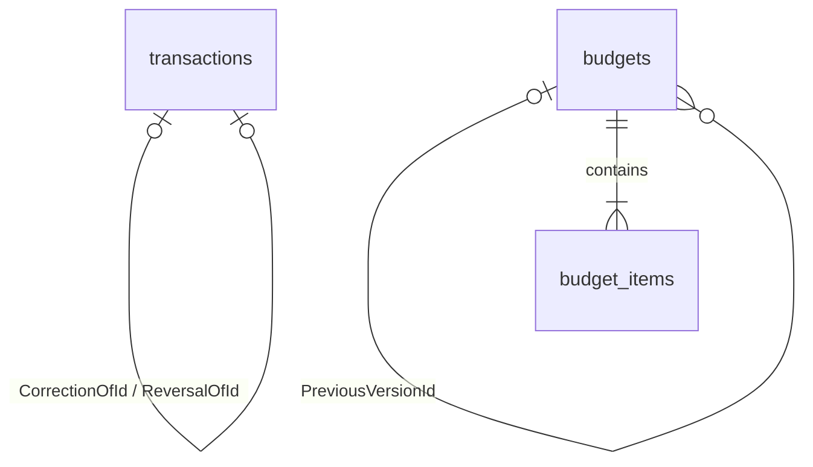

# Phase 3.1 业务完整性与报表准备

验收日期：2026-10-31（Asia/Shanghai）。本文件替代旧阶段文档中相关限制。

## 业务规则与实现

### 统计口径

GET /api/v1/organizations/{org}/reporting-basis 支持 dateFrom/dateTo（业务日期，包含两端）。使用 RepeatableRead 快照，按币种分别返回精确金额字符串：income、expense、opening、netCashMovement。企业内部转账不计企业收入或费用；期初独立展示。撤销以原交易类型的负数参与撤销日统计，例如撤销费用抵减费用，不列为新收入。净资金变动=收入-费用+期初。不同币种不直接相加。

同一接口的 documentOccurrences 按 IssueDate 汇总未取消应收/应付的单据发生额，不按收付款时间计算，也不与资金流量相加。它不是会计收入、成本或利润；复式记账和会计期间在 Phase 5 实现。预算按费用分类及业务日期统计净支出，反向流水抵减费用。

### 更正关联

POST /transactions 或 /transfers 可带 correctionOfId。原交易必须属于本企业、已撤销且不是撤销流水；结算单据关联必须保持相同。一个原交易只允许一个直接更正，数据库具有企业复合外键与唯一索引。更正再次出错，应撤销该更正，再以该更正作为下一次原交易。详情返回 transaction.correctionOfId、reversedBy、correctedBy，界面展示链条。撤销和重新登记仍为两个明确步骤；网络中断可按请求编号重试。

### 创建与结算重试

创建往来方、应收、应付、预算接受可选 requestId（非空 UUID）。界面自动生成并在失败后保留相同内容的请求编号。服务端以企业+编号事务锁串行化创建，保存请求内容摘要；首次201，相同编号与内容重试200，不同内容409。编号作用域为企业内对应资源类型，旧客户端不带编号仍可使用，但无法获得此创建重试保证。单据编号唯一约束继续有效。收付款及撤销保留原有 requestId 机制。

结算、取消、结算撤销均在资金锁之前锁定同一张单据，避免超额结算和取消后继续收付款。多账户同时结算同一单据也遵循此规则。

### 预算生命周期与调整

新预算 Draft；POST /budgets/{id}/status，body={"status":"Active"} 启用，或 {"status":"Closed"} 关闭已启用预算。关闭后不可重新启用。相同企业、币种、分类、含边界日期区间的启用预算不能重叠；按企业事务锁串行化检查。

调整预算通过创建新预算并指定 previousVersionId；金额、期间、分类在新版本中制定，保留原币种。启用新版本时在同一事务关闭其仍启用的原版本，并写审计；其他重叠预算仍阻止启用。预算执行允许查看草稿预览和已关闭历史。旧预算迁移为 Active；不会静默合并历史可能重叠的预算。预算只预警，不阻止付款；多级审批属于后续业务范围。

### 权限、停用与日期

权限逐请求查询企业成员，不依赖令牌中的旧角色；已有会话在角色变化后立即受新权限限制。当前只提供新增成员，没有修改或移除成员接口；Owner不可通过新增成员接口创建或覆盖，Admin不能管理Owner。因此目前不存在删除最后一位Owner的接口路径。

停用/归档往来方阻止新单据，允许处理已有单据。结算账户及分类必须Active；停用后需重新启用才能结算。撤销继续允许Inactive账户，但Archived账户须先启用。界面展示处理说明。业务日期允许历史及未来登记，表示已登记账务日期，不是定时付款；不代表任务将在未来执行。始终检查当前余额，历史每日负余额通过 /historical-balance-warnings 单独提示，最多100个账户日期结果，不自动改账。界面提供“检查历史负余额”。会计期间封账仍在Phase 5。

### 查询与审计

账户、分类、往来方支持服务端名称搜索；业务选择器按关键词请求最多100项，更多结果可缩小关键词，不再全量下载或依赖往来方列表当前页。核心财务选择器保留分页并增加搜索。

应收/应付列表新增 status、currency、dueFrom、dueTo、sort=asc/desc，先筛选后分页，到期日加ID稳定排序。单据详情提供分页结算历史，界面可翻页。

审计列表新增 actorId、action、resourceId、from、to，仍仅Owner/Admin可读。界面可按这些条件筛选。Excel导出审计只保存筛选条件和实际条数，不保存整份导出内容。

ProblemDetails保留traceId，增加稳定业务代码：INSUFFICIENT_FUNDS、SETTLEMENT_EXCEEDS_REMAINING、IDEMPOTENCY_CONFLICT、DOCUMENT_NUMBER_CONFLICT、RESOURCE_INACTIVE、BUDGET_OVERLAP；其他错误仍使用HTTP状态代码。

## 数据结构与部署

新增迁移 BusinessHardening：transactions.CorrectionOfId；counterparties/receivables/payables/budgets.RequestHash；budgets.Status、PreviousVersionId。更正及预算前版本均有企业复合外键。无需新服务。

按README执行 ./scripts/migrate.ps1 后重建API。迁移脚本重新配置运行权限：预算仅额外允许更新Status，金额及版本关系不能由运行账号更新；流水与审计保持只追加。

## 备份与恢复

backup.ps1生成备份后自动在独立数据库恢复，验证账户余额对流水、应收应付净结算上下界、取消状态、撤销金额关联和预算明细引用。随后记录恢复出的账户/交易/单据/预算明细规范化摘要到同名.business-digest。后续verify-restore.ps1对同一备份重验并比对摘要，包含重算预算执行所需的资金、日期、分类、币种和计划明细。摘要验证恢复内容一致，不能替代备份加密或外部防篡改。旧备份没有摘要时明确提示，仅做一致性检查。恢复库结束后自动删除。

## 实际验证

- 后端全量30通过、0失败：新增创建并发重试、状态筛选、预算版本/重叠、更正统计、审计筛选、结算取消竞态、撤销结算竞态、多账户结算、历史负余额、未来日期、旧会话角色变化等验证。
- 受限数据库账号预算启用/关闭及原有只追加保护单独复验通过。
- 前后端构建成功，后端0警告0错误；前端主JS480.60KB，业务扩展按需加载18.80KB。
- 两条真实Chromium流程通过，新增预算启用、调整版本、旧版关闭和单据状态筛选。
- Docker Linux API已构建启动，实际受限账号业务冒烟通过；Excel HTTP200，资金撤销核对最终0.0000。
- 备份及独立恢复成功，迁移历史6条；重复恢复摘要比对通过。
- EF模型与迁移一致；最终健康检查ready，测试/恢复临时库清理完成。

## Phase 4准备

已具备Dashboard、收支趋势、现金流、预算可视化的数据口径基础。Phase 4应复用本阶段定义，保留精确金额文本和按币种展示；对图表展示值与金额计算分开处理。PDF组件许可证须在引入时核实。生产证书部署、远程CI、备份外部加密保管及10万条性能验收仍按后续部署和优化阶段执行，本阶段不将本地验证等同生产验收。
