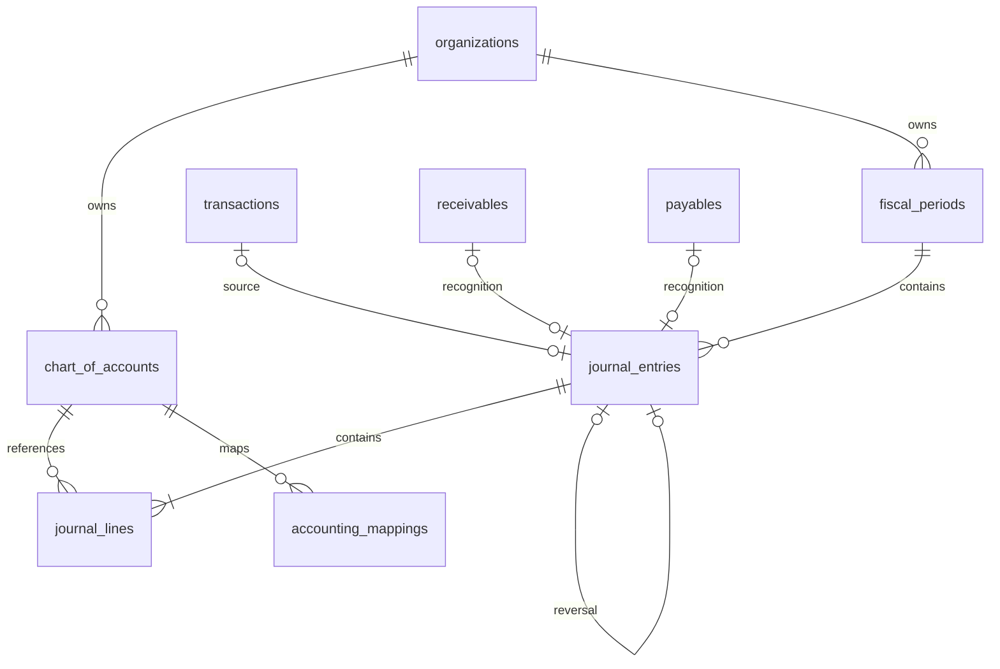

# Phase 5 会计引擎与性能优化

验收日期：2026-11-01，Asia/Shanghai。本阶段基于Phase 4继续开发，未引入微服务、队列、Redis或后台任务。

## 已实现的业务规则

会计账与资金账分别保存。资金流水负责收付款，凭证负责复式记账；生成和过账凭证不会再次改变资金余额。来源编号在企业内唯一，防止重复确认。未生成或未过账来源在界面可查询，封账前必须处理。

会计科目分Asset/资产、Liability/负债、Equity/权益、Revenue/收入、Expense/费用。代码在企业+币种内唯一，代码、币种、类别、上级创建后固定，支持启停。父子必须同类别同币种；只可向有效明细科目过账；已有分录或映射用途的科目不允许再增加子级。历史分录不随科目停用改写。

草稿须2–200行，每行只能有借方或贷方正金额，借贷总额相等且不超过NUMERIC(19,4)上限。所有API金额使用精确字符串；数据库新增有限值约束，拒绝NUMERIC特殊NaN。手工草稿支持带Version的修改；陈旧版本409。来源草稿要调整映射时先删除草稿再生成。删除只适用于未过账草稿，审计保留其原内容。

过账在同一事务中分配期间流水号、保存借贷合计及审计。重复过账幂等，不重复分配号码。数据库触发器再次检查借贷相等、科目和期间；已过账表头及分录禁止更新删除，运行角色没有更改历史金额的权限。冲销追加借贷互换的凭证，原凭证保持不变，一张原凭证只能冲销一次，不允许冲销冲销凭证。

会计期间不重叠，关闭后不提供重新开放接口。尚未建立期间的旧企业继续原资金业务；建立期间后，新资金流水、资金撤销和新单据的业务日期必须属于开放期间。关闭检查草稿、截至期末未过账来源、有效单据的会计确认及已映射资金与总账差额；未映射资金账户也须处理。不能通过关闭期间掩盖漏记或资金差异。期间不会自动做年度损益结转。

## 来源映射与正确入账流程

|用途|科目类别|示例|
|---|---|---|
|FinancialAccount|Asset|每个资金账户对应银行/现金明细科目|
|Category（Income）|Revenue|普通业务收入|
|Category（Expense）|Expense|普通费用|
|Opening|Equity|期初权益，resourceId为全零UUID|
|Receivable|Asset|应收控制科目，resourceId为全零UUID|
|Payable|Liability|应付控制科目，resourceId为全零UUID|

控制科目与资金科目分开。已经有资金来源凭证过账的资金账户不能更换映射；分类后续映射变化不重写既有凭证。

- 普通收入：借资金，贷收入；普通费用：借费用，贷资金。
- 期初：借资金，贷期初权益；转账：借转入资金，贷转出资金。
- 应收确认：借应收，贷收入；收款：借资金，贷应收，避免再次确认收入。
- 应付确认：借费用，贷应付；付款：借应付，贷资金。
- 资金反向流水：先过账原流水凭证，再导入反向流水，分录精确反转原凭证，不按新映射重算。

资金来源凭证不能脱离资金流水直接冲销；应先在资金模块撤销，再生成和过账反向凭证。单据确认凭证须先将净资金结算撤回到零，才允许冲销；取消已有会计确认的单据前必须冲销其确认凭证。确认已冲销的单据不能继续新收付款，应取消后重建。

手工凭证允许表达其他会计调整，但不会自动产生资金流水；若直接调整已映射资金科目造成差额，须在资金账或会计账中按正确业务补齐，系统只报告差异、不自动改账。试算表提供收入、费用与会计收支差额，非税务申报利润；没有税费、折旧、坏账、汇率自动计算或年度自动结转。

## 模块和ER

AccountingService负责科目、期间、来源映射与凭证生命周期；AccountingReports负责试算、科目明细和资金对账；AccountingApi负责权限、DTO及错误响应。复用Identity、FinancePermissions、审计及现有事务基础设施。



所有关联均含企业复合外键；多态资源映射由服务验证资源企业和用途，既有资金账户和分类禁止删除。新增AccountingEngine、PerformanceIndexes、FiniteMoneyGuards迁移，目前共10条。AccountingEngine通过嵌入资源安装触发器，数据库恢复会包含触发器定义。

会计期间变更使用企业级排他事务锁；资金写入先取得共享事务锁，再按原有固定顺序锁账户。这样不同账户仍可并发写入，同时封账不能与正在提交的资金业务擦肩而过。资金交易重试会先识别原请求，已提交请求在封账后仍能查询并返回原结果。

## API

前缀：/api/v1/organizations/{org}/accounting。全部已知成员可读，Owner/Accountant可写，Admin无资金及会计写权限，外企业404，越权403。

|路径|方法|用途|
|---|---|---|
|/accounts|GET、POST|科目分页、搜索与创建|
|/accounts/{id}/status|PATCH|启停科目|
|/periods|GET、POST|期间分页与创建|
|/periods/{id}/close|POST|检查并关闭期间|
|/mappings|GET、PUT|分页查看、设置来源映射|
|/sources|GET|按Transaction/Receivable/Payable查看待生成来源|
|/journals|GET、POST|凭证分页、状态日期筛选、建立手工草稿|
|/journals/{id}|GET、PUT、DELETE|详情、版本校验修改手工草稿、删除草稿|
|/journals/{id}/post|POST|带version过账|
|/journals/{id}/reverse|POST|带requestId、businessDate、reason冲销|
|/import|POST|带requestId、sourceKind、sourceId生成来源草稿|
|/trial-balance|GET|dateFrom/dateTo/currency试算和会计收支分析|
|/ledger/{id}|GET|按日期分页科目明细|
|/reconciliation|GET|dateTo/currency资金与总账核对|

列表最大100项；试算表最多5000科目，日期最多3661天。金额均4位小数字符串。凭证编号在过账时生成，草稿显示ID；草稿合计字段为未过账的0，详情显示真实分录。科目选择器使用当前搜索结果，映射列表显示前100项，超出可通过分页API访问。

手工草稿示例：

```json
{"requestId":"非空UUID","businessDate":"2026-11-01","currency":"CNY","description":"期初会计调整","lines":[{"ledgerAccountId":"资产科目UUID","debit":"100.0000","credit":"0"},{"ledgerAccountId":"权益科目UUID","debit":"0","credit":"100.0000"}]}
```

## 本地复现与验证

沿用README安装及启动步骤；先执行迁移再更新API，migrate脚本会重新授予受限列权限。选择企业后点击“打开会计引擎”。不要用真实企业做部署验收。

    ./scripts/migrate.ps1
    docker compose up -d --build api
    npm run dev --prefix frontend
    dotnet test CFIS.slnx
    ./scripts/test-browser.ps1
    ./scripts/smoke-accounting.ps1
    ./scripts/backup.ps1

测试连接按README设置CFIS_TEST_ADMIN。smoke-accounting会保留明确标识的验收企业，追加原凭证与冲销凭证，最后净额为零并关闭期间。

已验证：后端全量42项通过；新增会计9项覆盖平衡、精度、并发、幂等、Version、来源不重复确认、跨企业、Viewer越权、封账竞态、单据取消、审计回滚及真实最小权限角色。浏览器3条真实流程通过，新增科目、分录、过账、冲销、试算、明细及封账。主库受限账号冒烟通过，借贷20.2468、差额0.0000；10条迁移备份恢复通过，恢复库登录和企业隔离通过。

运行账号对会计科目仅可改Active；期间仅可改状态、计数和关闭时间；表头仅可改草稿必要字段/过账字段。数据库触发器阻止修改已过账记录。恢复摘要升级v4，含科目、期间、凭证、分录和映射；恢复检查重算已过账借贷合计及期间边界。

## 性能验收

详见performance-phase-5.md及performance/phase-5-results.json。实际生成10万目标交易、10万背景交易、10万已过账凭证与20万分录；无模拟API。k6两轮10VU各25秒，最终均无HTTP失败、全部检查通过。发现并修复Docker默认共享内存不足导致并行聚合失败，PostgreSQL配置shm_size=256mb。

索引优化保持查询和业务结果不变，数据库内聚合、AsNoTracking、分页，避免逐行查询。当前实测未显示需要Redis；资金和会计报表继续no-store，保证过账后即时可见，缓存策略为暂不缓存结果。未来若引入缓存，须同时按企业、币种、日期、记录截止和账务版本隔离并可靠失效。

本阶段不进入Phase 6正式生产部署、安全全面验收或额外业务扩展。

## 最终远程验收

该阶段GitHub Actions全部通过，含解决方案构建、42项后端测试、数据库迁移、前端构建及3条真实浏览器流程。此项为阶段历史验收记录。本地构建0警告0错误，依赖扫描未报告已知漏洞；性能、测试及恢复临时库已清理。性能脚本已负向验证拒绝非临时数据库名称，清理分支再次校验目标前缀，防止误删主库。
